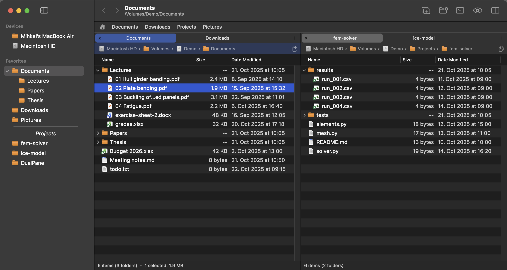
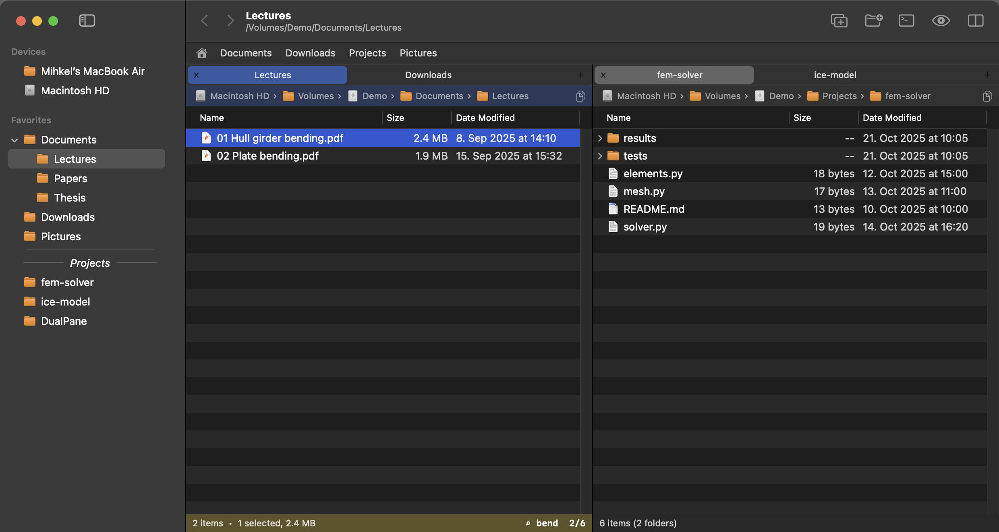
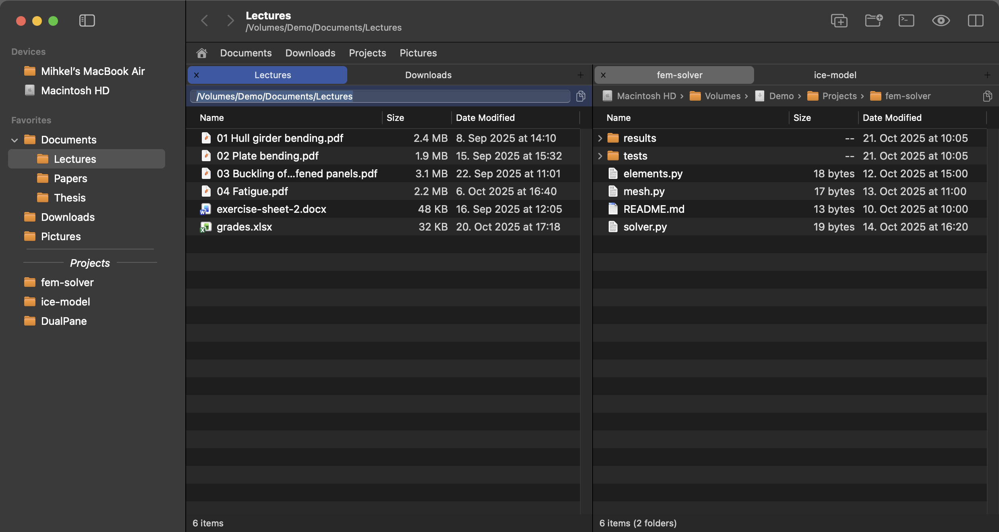

# DualPane

A small native macOS two-pane file manager, written as a Finder / Path Finder replacement
with Total Commander style type-to-filter. Swift + AppKit, no dependencies, no Xcode project:
it builds with the command line tools only.

Layout, top to bottom: toolbar (back/forward, new tab, new folder, open the current folder in
iTerm, hidden files, second pane), quick-access row of favourite folders, then one or two
panes. Each pane has its own tabs, a clickable path bar, the file list and a status line with
the item count and the size of the selection. The sidebar on the left lists devices and
favourites. The window title shows the active folder and its path.

## Features

### Two panes and tabs

- Two panes side by side, each with its own folder history and tabs. ⌘⇧P or the toolbar
  button hides the second pane; the choice is remembered.
- Tabs: ⌘T new, ⌘W close (closes the window when it is the last tab), ⌃Tab / ⌃⇧Tab or
  ⌘1…⌘9 to switch, drag to reorder, middle-click or × to close, double-click the empty strip
  for a new tab. Tabs are remembered across launches.
- Tab switches pane, ⌘U swaps the panes, ⌘E shows the same folder in the other pane, ⌥→ /
  ⌥← push the current folder into the other pane, ⌘⇧⌥O opens the selected folder in the
  other pane and ⌘^O in a new tab.
- F5 / F6 copy / move the selection to the other pane.

### Type to filter

- Type letters to narrow the list to names containing what you typed, anywhere in the name.
  Case and diacritics are ignored. The yellow bar at the bottom shows the filter and how many
  items match, or tells you when nothing matches.
- Backspace deletes the last letter, or goes to the parent folder when there is no filter.
  Esc clears the filter, then the selection.
- Return opens the first match, so `dow` Return enters Downloads from your home folder.

### Folder peek

- Every folder row has a triangle in front of it. Click it (or press → with the row selected;
  ← closes it again) to show the folder's contents indented beneath it, as in Finder's list
  view, without leaving the folder you are in. Folders inside can be opened the same way.
- Open folders stay open while the list refreshes, changes inside them show up as they
  happen, and the typed filter and the sort order apply inside them too.
- Rows from different folders can be selected together; rename, trash, copy and the other
  commands act on each item where it is.
- Drop onto a folder row to put items into that folder; a drop on a file inside an open
  folder goes into that folder, anywhere else into the folder you are in.

### Path bar

- Shows the real path from the volume root, one crumb per folder. Click a crumb to go there,
  ⌘-click to open it in a new tab. Right-clicking a crumb offers Copy Path / Open in New Tab /
  Reveal in Finder for that folder.
- Click the empty part of the bar (or press ⌘L) and it turns into a text field with the full
  path selected: ⌘C copies it, typing a path and pressing Return goes there, Esc returns to
  the crumbs. The small copy button at the right end copies the folder path.
- Symlinked folders (such as `~/OneDrive - …`, which points into `~/Library/CloudStorage`) are
  followed, as in Finder.

### Sidebar

- Devices (mounted volumes) and favourites. Drag folders in to add them, drag to reorder,
  right-click to remove or to add a separator. Click goes there, ⌘-click or double-click opens
  a new tab. ⌘^T adds the selected folder, ⌘⌥S hides the sidebar.
- Favourites can be nested: drop a folder (or another favourite) onto a favourite to put it
  inside, shown indented beneath it with a triangle that hides or shows the nested rows
  (remembered across launches; ← and → on a selected row do the same). Drop between rows to
  keep it at that level, and right-click a favourite for "Add Folder Inside…" or "Move Out
  of …". Removing a favourite removes the folders inside it too.
- Right-click a favourite and choose "Show as Separator" to draw it as a divider line with
  its name centred on it in italics; it still opens on click, so a folder can head the group
  of favourites below it.
- Finder alias files can be dropped in too (or added with ⌘^T): they keep their own name and
  open their original folder.
- The Go → Favorites menu mirrors the sidebar.

### Quick access row

- Drop folders on it to add, right-click a button to remove, right-click the row to add the
  current folder. Click goes there, ⌘-click opens a new tab.

### Files

- New folder (F7 / ⌘⇧N, opens rename at once), new empty file (⌘⌥N), duplicate (⌘D), move
  to Trash (F8 / ⌘⌫).
- Rename with F2 / ⌘Return, or Finder-style: click the name of the already selected item and
  pause (a slow double-click); a real double-click still opens it.
- Batch rename: with several items selected, F2 / ⌘Return (or Rename in the right-click
  menu) gives all of them the typed name plus _001, _002… in order of modification date,
  oldest first, each keeping its extension.
- Cut / copy / paste (⌘X / ⌘C / ⌘V; cut items are moved, copied ones copied) and Move Items
  Here (⌘⌥V) for copied items. Works with Finder in both directions.
- ⌘⌥C copies the path(s) of the selection, or the current folder's path when nothing is
  selected.
- Quick Look with Space or ⌘Y; the arrow keys move the selection while the panel is open.
- Open With submenu (right-click and File menu) lists every application that can open the
  selected files, default app first, with Other… (⌘⌥O) to pick any application.
- Get Info (⌘I), Reveal in Finder (⌘⇧F), Show Package Contents.
- Double-clicking a Finder alias to a folder enters that folder.

### Drag and drop

- Within DualPane and from Finder: same disk moves, other disk copies, hold ⌥ to force a
  copy. Drop on a folder row (or an alias row) to put items into that folder, on the sidebar
  to make a favourite, on the quick access row to add a button.
- Drops from Mail, Photos and browsers are received as file promises into the folder (a
  copy; an existing name is kept and the new file gets a "copy" suffix).

### Navigation

- Back / forward (⌘[ / ⌘]), enclosing folder (⌘↑ or Backspace), Return / ⌘↓ / ⌘O /
  double-click to open (folders are entered).
- Go menu: Home, Desktop, Documents, Downloads, Applications, Volumes, Macintosh HD, the
  favourites, Go to Folder (⌘⇧G) and Edit Path (⌘L).
- Column headers sort by name, size or date; folders always stay on top.
- Hidden files are shown by default; ⌘⇧. toggles them. ⌘R refreshes, but folders refresh by
  themselves when something changes in them.
- Help → Keyboard Shortcuts (⌘?) lists the keys inside the app.

### Terminal, Finder and other apps

- ⌘⌥T (and the toolbar button) opens the selected folder, else the current one, in iTerm, or
  in Terminal when iTerm is not installed.
- Open a folder from the shell, or reveal a file (its folder opens with the file selected,
  also at a cold launch):

      open -a DualPane ~/Documents
      open -a DualPane ~/Downloads/paper.pdf

- Make DualPane the default application for folders, so `open ~/Documents` and folders opened
  from other apps land here (`off` hands them back to Finder; "Reveal in Finder" always stays
  with Finder):

      swift Tools/set-default-folder-app.swift on

- **Default Folder X**: the folders open in DualPane's tabs are listed in Default Folder X's
  Finder Windows menu (under Recently Closed) in every Open/Save dialog, and leave the list
  again when their tab closes or moves on. Entries that were already there are moved to the
  top but never removed. macOS asks once whether DualPane may control Default Folder X.
  Default Folder X's Finder-click only knows its own file browsers, so clicking a DualPane
  window behind a dialog does nothing.

### Remembered between launches

Tabs and their folders, the window size, the sidebar width and whether it is hidden, the
second pane, column widths, the hidden-files setting, the favourites, the quick access row
and which nested favourites are collapsed.

## Build and install

Requirements: macOS 13 or later and the Xcode Command Line Tools (`xcode-select --install`).
There is no Xcode project and no package dependency; `build.sh` is one `swiftc` call.

    ./build.sh              # -> build/DualPane.app
    ./build.sh install      # -> ~/Applications/DualPane.app

The app is signed ad hoc on your own machine, so Gatekeeper lets it run.

## Keys

| Key | Action |
|---|---|
| letters | narrow the list to names containing what you typed, anywhere in the name (yellow bar shows the filter) |
| Backspace | delete last filter letter, or go to the parent folder when no filter |
| Esc | clear filter / deselect |
| Return, ⌘↓, ⌘O, double-click | open; folders are entered |
| ⌘↑ | enclosing folder |
| → / ← | open / close the selected folder's rows in place (folder peek) |
| ⌘[ / ⌘] | back / forward |
| Tab | switch pane |
| Space / ⌘Y | Quick Look |
| F5 / F6 | copy / move selection to the other pane |
| F7 / ⌘⇧N | new folder (opens rename) |
| ⌘⌥N | new empty file |
| F2 / ⌘Return | rename; with several items selected (also from the right-click menu), all get the typed name plus _001, _002… in order of modification date, oldest first, each keeping its extension |
| F8 / ⌘⌫ | move to Trash |
| ⌘D | duplicate |
| ⌘X / ⌘C / ⌘V / ⌘⌥V | cut / copy / paste (cut items are moved, copied ones copied) / move copied items here (works with Finder too) |
| ⌘⌥C | copy path(s); the current folder's path when nothing is selected |
| ⌘L | edit the path bar as text (copy it with ⌘C, Return goes to the typed path) |
| ⌘E | same folder in the other pane |
| ⌥→ / ⌥← | from the left pane, show its folder in the right pane / from the right pane, show it in the left (only while both panes are shown) |
| ⌘U | swap panes |
| ⌘⇧P | hide / show second pane |
| ⌘⌥S | hide / show sidebar |
| ⌘T / ⌘W | new tab / close tab (closes the window when it is the last tab) |
| ⌃Tab / ⌃⇧Tab, ⌘1…9 | next / previous tab, tab by number |
| ⌘^O | open selected folder in a new tab |
| ⌘⇧⌥O | open selected folder in the other pane |
| ⌘^T | add selected folder to the sidebar |
| ⌘⇧. | show / hide hidden files (shown by default) |
| ⌘R | refresh (folders also refresh automatically) |
| ⌘⇧G | go to folder |
| ⌘⇧H / D / O / A / C | Home / Desktop / Documents / Applications / Volumes |
| ⌘⌥L | Downloads |
| ⌘⇧F / ⌘I | reveal in Finder / Get Info |
| ⌘⌥T | open the selected folder (else the current one) in iTerm, or in Terminal when iTerm is not installed |
| ⌘⌥O | Open With → Other… |
| ⌘? | keyboard shortcuts |
| drag & drop | same disk moves, other disk copies, hold ⌥ to force copy |
| drop from Mail, Photos, browsers | file promises are received into the folder (a copy; an existing name is kept and the new file gets a "copy" suffix) |

Right-click gives the same commands as a context menu.

## Licence

MIT, see [LICENSE](LICENSE).
